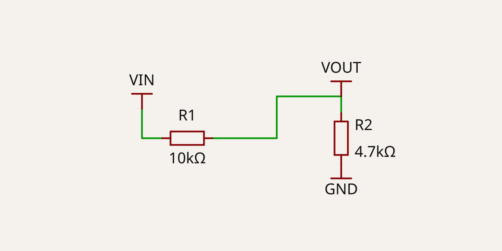
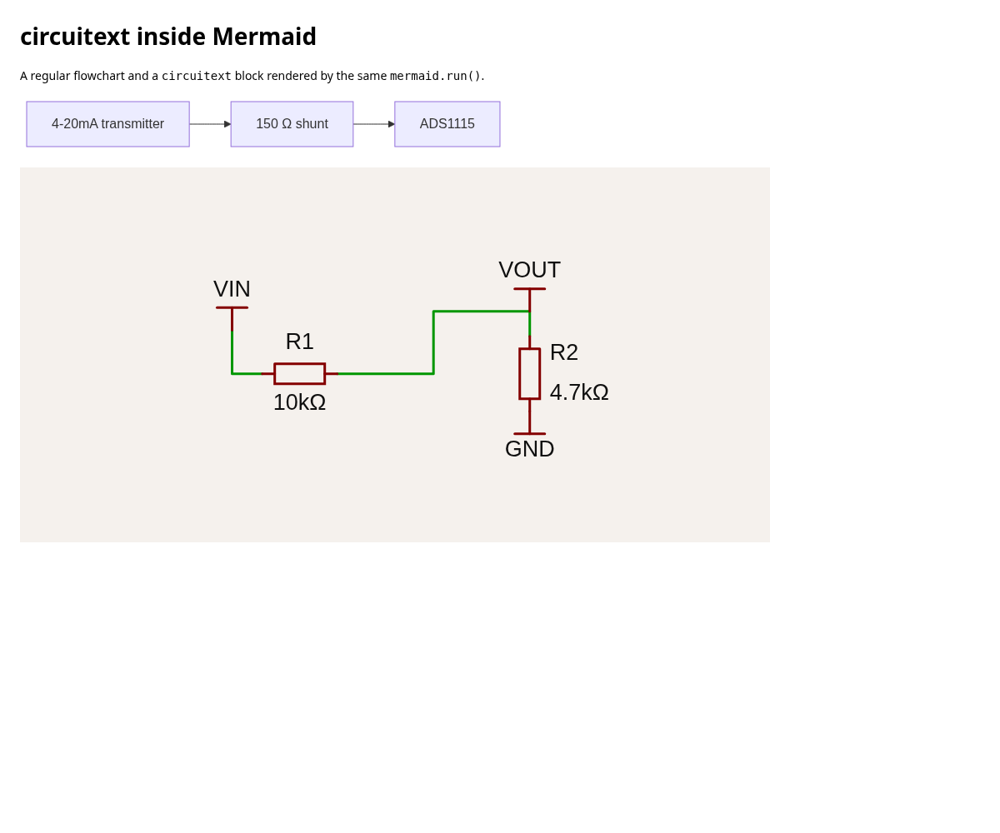
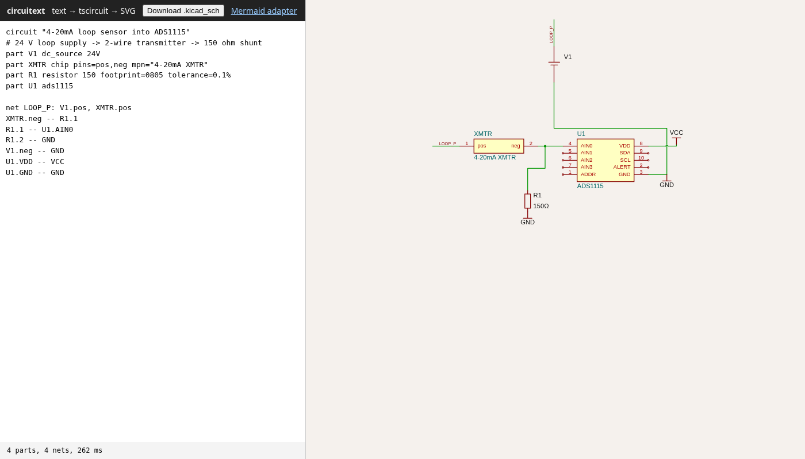
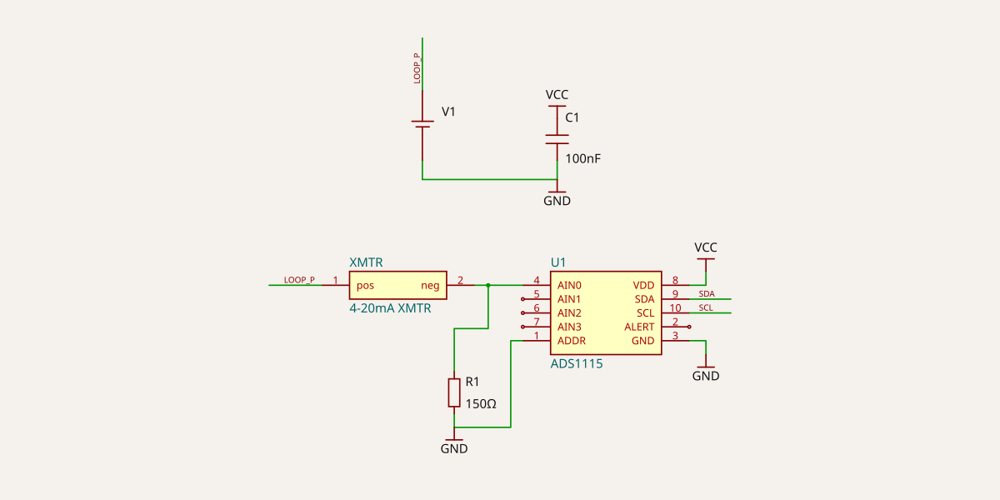
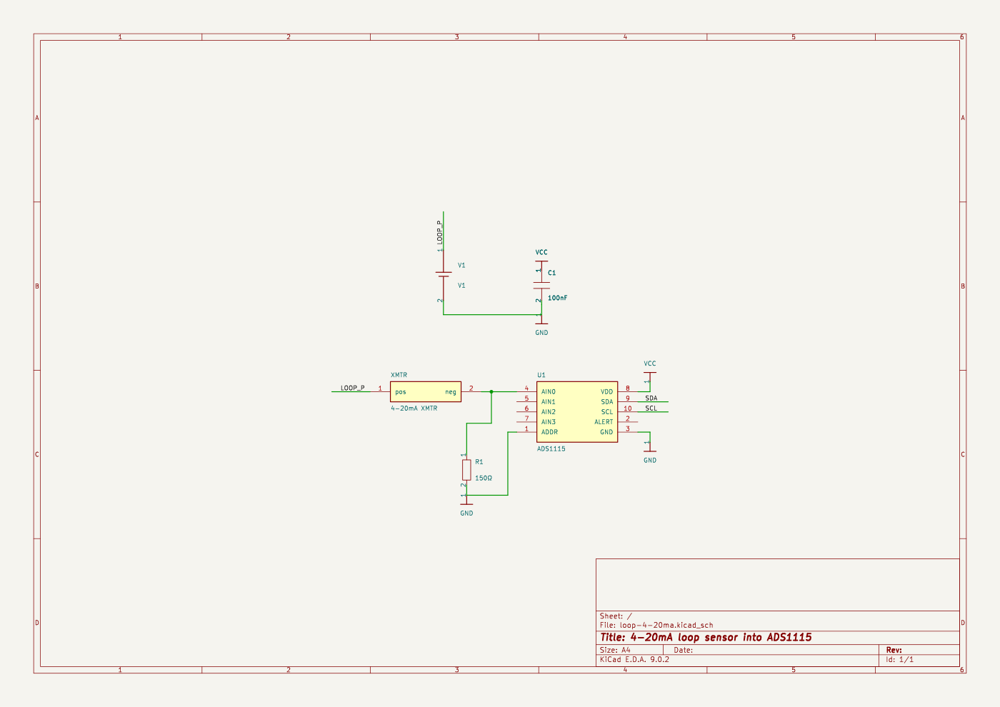

# circuitext

**Mermaid for circuits.** It's a short, declarative text syntax, inspired by SKiDL. It compiles to
[tscircuit](https://tscircuit.com) Circuit JSON and renders a schematic SVG. It also exports a KiCad
`.kicad_sch` that opens in KiCad 9.

> **Status: prototype.** The syntax, the API and the output may all change. It isn't published to npm.

```text
circuit "Voltage divider"
# VOUT = VIN * R2 / (R1 + R2)
part R1 resistor 10k
part R2 resistor 4.7k

VIN -- R1.1
net VOUT: R1.2, R2.1
R2.2 -- GND
```



## Why

Mermaid made diagrams-as-text normal in Markdown, but it has no circuit diagram type
([mermaid-js/mermaid#2112](https://github.com/mermaid-js/mermaid/issues/2112)). circuitext tries that idea
with a real electrical backend underneath. The text becomes an actual netlist, built by tscircuit. From
there it renders a schematic, exports to KiCad, and can show up inside Mermaid as an external diagram.

## Install (from source)

Requires Node 20 or newer.

```sh
git clone https://github.com/carefreeinv/circuitext && cd circuitext
npm ci && npm run build
npx circuitext render examples/voltage-divider.ckt -o divider.svg
```

## Syntax reference

A source file (by convention `*.ckt`) is line-based. Each line holds one statement.

| Statement | Example | Meaning |
|---|---|---|
| title | `circuit "4-20mA loop"` | Optional diagram title. It's used for the KiCad title block. `circuitext` is also accepted, and Mermaid uses that form. |
| part | `part R1 resistor 10k footprint=0805` | `part REF TYPE [VALUE] [key=value ...]` |
| connection | `R1.2 -- U1.AIN0 -- C1.1` | Chains connect every endpoint to the same net. |
| named net | `net VOUT: R1.2, R2.1` | Declares a net, optionally with members. `net SDA` alone is fine too. |
| comment | `# ...`, `// ...`, `%% ...` | These run to the end of the line and are ignored inside quotes. |

**Endpoints**

- `REF.PIN` is a part pin. `PIN` can be a pin number (`1`), a pin label (`AIN0`, case-insensitive), `pinN`,
  or an alias such as `pos`/`neg`, `anode`/`cathode`/`a`/`k`, `b`/`c`/`e`, `g`/`d`/`s`, or `left`/`right`.
- A bare `NAME` that isn't a part ref is a net. **GND** and **VCC** (and names like `V3V3`) are ordinary named
  nets. tscircuit draws them with ground and power-rail symbols.
- Net names have to suit tscircuit, so `3V3` becomes `V3V3`, `+5V` becomes `V5V` and `-12V` becomes `N12V`.
  You'll get a warning when that happens.

**Values and props**

- The positional value goes to the part's main prop: `resistance`, `capacitance`, `inductance`, `voltage`,
  LED `color`, and so on. Units are kept as written (`10k`, `100nF`, `24V`).
- `key=value` props are passed through to the tscircuit element. Comma lists are allowed (`pins=VDD,GND,SDA`)
  and quotes are allowed (`mpn="LM358 dual"`). `true`/`false` and plain numbers are coerced.
- Shorthands: `x`/`y` become `schX`/`schY`, `rotate` becomes `schRotation`, and `mpn` becomes
  `manufacturerPartNumber`.
- Generic chips: `part U2 chip pins=IN,OUT,GND left=IN right=OUT bottom=GND`. The `left`/`right`/`top`/`bottom`
  props set the schematic pin arrangement.

**Part types**

| Type (aliases) | tscircuit element | Notes |
|---|---|---|
| `resistor` (`r`, `res`) | resistor | default 0402 |
| `capacitor` (`c`, `cap`) | capacitor | pins `pos`/`neg` |
| `inductor` (`l`) | inductor | |
| `diode` (`d`), `led` | diode / led | `anode`/`cathode` |
| `fuse` | fuse | value = currentRating |
| `battery` (`dc_source`, `vdc`) | battery | `pos`/`neg` |
| `vsource` (`ac_source`), `isource` (`current_source`) | voltagesource / currentsource | |
| `npn`, `pnp` | transistor | `c`/`b`/`e` |
| `nmos`, `pmos` | mosfet | `d`/`g`/`s` |
| `pot` (`potentiometer`), `crystal` (`xtal`), `switch`, `button` (`pushbutton`) | … | |
| `opamp` | opamp | `inp`/`inn`/`out`/`vcc`/`vee` |
| `testpoint` (`tp`), `header` (`connector`, `conn`) | testpoint / pinheader | header: `pins=` or a count value |
| `chip` (`ic`) | chip | `pins=` list, optional side arrangement |
| `ads1115`, `ne555` | chip | small built-in library with pinout, footprint and MPN |

**Diagnostics.** Errors come with `file:line:col` and cover:

- unknown part types or pins (the valid pins are listed)
- duplicate refs
- a bare part ref used as an endpoint
- shorts between two named nets

## CLI

```text
circuitext render  <in.ckt> [-o out.svg]        schematic SVG (circuit-to-svg)
circuitext kicad   <in.ckt> [-o out.kicad_sch]  KiCad schematic (circuit-json-to-kicad)
circuitext json    <in.ckt> [-o out.json]       tscircuit Circuit JSON
circuitext tsx     <in.ckt> [-o out.tsx]        equivalent tscircuit TSX
circuitext netlist <in.ckt>                     resolved nets (text)
circuitext check   <in.ckt>                     parse + validate only
  -w, --warnings   also show tscircuit warnings     --grid   draw grid      '-' = stdin
```

## JS API

```ts
import { compile, renderSvg, renderKicadSch, parse, resolve, toTsx } from "circuitext"

const svg = await renderSvg(source)            // schematic SVG string
const sch = await renderKicadSch(source)       // .kicad_sch string
const { circuitJson, netlist, diagnostics } = await compile(source)
const tsx = toTsx(resolve(parse(source)))      // hand off to a real tscircuit project
```

## Mermaid adapter

```ts
import mermaid from "mermaid"
import circuitext from "circuitext/mermaid"

await mermaid.registerExternalDiagrams([circuitext])
mermaid.run()
```

Inside Markdown or HTML, any Mermaid block that starts with `circuitext` renders as a schematic:

````md
```mermaid
circuitext "Divider"
part R1 resistor 10k
...
```
````



## Browser demo

`npm run demo` bundles with esbuild into `demo/dist/` and serves `demo/`. It includes:

- `index.html`, a live editor with an SVG preview and a `.kicad_sch` download
- `mermaid.html`, which uses the Mermaid adapter

The bundle is large (~14 MB unminified), because tscircuit core runs in the page.



## Examples

| Source | SVG | KiCad |
|---|---|---|
| [`loop-4-20ma.ckt`](examples/loop-4-20ma.ckt): a 24 V loop, a 2-wire transmitter and a 150 Ω shunt (0.6–3.0 V) into ADS1115 AIN0 | [svg](examples/loop-4-20ma.svg) | [kicad_sch](examples/loop-4-20ma.kicad_sch) |
| [`voltage-divider.ckt`](examples/voltage-divider.ckt) | [svg](examples/voltage-divider.svg) | [kicad_sch](examples/voltage-divider.kicad_sch) |
| [`555-blinker.ckt`](examples/555-blinker.ckt): a 555 astable driving an LED | [svg](examples/555-blinker.svg) | [kicad_sch](examples/555-blinker.kicad_sch) |



Here's the same loop opened by `kicad-cli` (KiCad 9.0.2):



`npm run examples` regenerates the examples, and CI fails if the committed outputs go stale.

## KiCad export and verification

`.kicad_sch` comes from `circuit-json-to-kicad`. circuitext then post-processes it so that KiCad 9 loads it
and its connectivity matches:

- `(power global)` becomes `(power)`, because KiCad 9.0 refuses to load the former.
- Wires are split at T-junctions. Otherwise KiCad leaves a branch unconnected when it ends mid-segment.
- Duplicate junctions are removed and a title block is added.
- UUIDs are renumbered deterministically, so the output can be diffed and committed.

`npm run verify:kicad` exports each example, runs `kicad-cli sch export netlist`, and checks that KiCad's net
groupings match the circuitext netlist. When `kicad-cli` is installed, the vitest suite does the same check;
otherwise it skips it.

## How it relates to…

- **tscircuit**: the backend. circuitext is a thin front end that builds tscircuit React elements and lets
  `@tscircuit/core` handle the schematic layout. `circuitext tsx` emits the equivalent TSX, so a circuit can
  move into a full tscircuit project.
- **SKiDL**: the inspiration for "parts plus connections, not drawing". SKiDL is Python code, while
  circuitext is a small declarative language meant for docs.
- **Mermaid**: circuitext copies Mermaid's "text in a fenced block" ergonomics and ships an
  [external diagram](https://mermaid.js.org/config/usage.html#registering-external-diagrams) adapter.
- **[mermaid-circuit](https://www.npmjs.com/package/mermaid-circuit)**: a Mermaid diagram type with a
  Schemdraw-style drawing core. It draws nice symbols from a `circuitDiagram` syntax (`R1 |B| --- |A| R2`).
  It only renders inside Mermaid, though. Its values are labels, and it has no netlist, tscircuit or KiCad
  output. circuitext puts electrical meaning first and exports to KiCad.
- **SchemaTex**: another text-to-schematic project. It's AGPL, and no code from it is used here.
- **netlistsvg**: renders Yosys/JSON netlists in the same spirit, aimed at digital logic.

## Known rough edges

- tscircuit's autolayout is fine for small circuits, but it gets busy on bigger ones. The 555 example has
  crossing wires. Use `x=`/`y=` props to place parts by hand.
- Named nets render as net labels or rails instead of drawn wires, which is a tscircuit design choice.
- `battery` doesn't print its voltage in the SVG. In KiCad it shows "V1 V1". `vsource` uses an AC symbol.
- In KiCad, symbols use the embedded `Device:`/`Custom:` libraries that tscircuit generates. ERC reports
  off-grid pins and dangling label stubs.
- The published `.d.ts` files of `@tscircuit/core` reference packages that ship raw TypeScript. TypeScript
  consumers need `skipLibCheck` or the path stub in [`types/stub.d.ts`](types/stub.d.ts).
- Compiling a circuit takes roughly 0.2–1 s.

## Development

```sh
npm run lint        # biome
npm run typecheck   # tsc over src, tests and demo
npm test            # build + vitest (parser, resolve, compile + SVG snapshot, kicad, mermaid, cli)
```

Dependency versions are pinned exactly, because tscircuit packages release often.

## License

MIT
